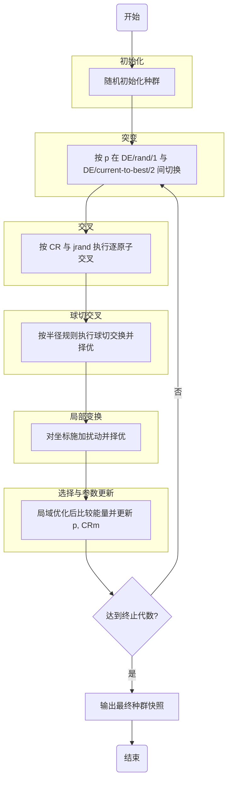

# SaNSDE_new

> 说明: 本文档由 LLM 辅助生成, 并结合当前代码, workflow 文档与知识库内容整理. 已通过人工复核.

## 代码简介

本仓库实现了一个面向纳米团簇全局优化的 SaNSDE 工作流, 核心模块集中在 `SaNSDE_new.py`.

- `Population`: 种群对象, 同一化学式(同元素组成与计数)的团簇集合.
- `localOptimize`: 局域优化函数, 输入 `Population | Atoms`, 返回新的优化对象(不原地修改输入).
- `randomCluster`: 随机生成团簇并局域优化后加入种群.
- `mutate`(突变)/ `crossover`(交叉)/ `sphereCutSplice`(球切交叉)/ `localTransformation`(局部变换)/ `select`(选择): SaNSDE 主循环核心环节.
- `relax`: 基于 `localOptimize` 的默认偏函数, 固定常用优化参数, 供后续一些团簇演化环节复用.

## 环境需求

- Python 3.13
- 依赖包:
  - numpy
  - [ase](https://ase-lib.org/)
  - [deepmd](https://docs.deepmodeling.com/projects/deepmd/en/master/index.html)(可选)

## 算法原理图




## 算法简介

本实现参考 `workflow/变异&交叉简介.md` 与知识库接口文档, 核心思想如下:

1. 初始化种群与自适应参数:
   - 变异策略概率 `p`
   - 缩放因子分布选择概率 `fp`
   - 交叉率中心 `CRm`
   默认初值均为 `0.5`.

2. 突变(Mutation):
   - 按 `p` 在 `DE/rand/1` 与 `DE/current-to-best/2` 之间切换.
   - 缩放因子 `F` 按 `fp` 在高斯分布与柯西分布之间采样.

> [!NOTE]
> 柯西分布重尾特性可能产生极大缩放因子, 导致突变后原子飞离. 实现中对柯西分支施加半径阈值约束, 不满足则重采样; 达到重采样上限时强制接受, 避免死循环.

3. 交叉(Crossover):
    - 按 `CR` 和 `jrand` 执行逐原子交叉, 保证每个试验个体至少继承一个突变原子.
    - 在个体上记录 `CR`, 并透传 `mutTag`.

4. 球切交叉(sphereCutSplice):
   - 从 `pop` 与 `popCross` 中随机抽样做球切交换.
   - 用质心移到原点后按半径规则交换外层原子.
   - 对候选结构 `relax` 后择优.

> [!NOTE]
> 用球面划分团簇A内外, 对于单元素团簇, 总存在一个球面使团簇B在该球面内外的原子数与之对应相等. 但合金团簇必须确保各元素原子数分别相同, 无法保证球面存在, 只能按元素分别选择团簇B距原点最远的原子, 可能选到靠近中心的原子. 若距离 $\leq d_{\max}^{\text{A}} \cdot r / 2$ 则拒绝重选; 达到上限时强制交叉, 避免死循环.

5. 局部变换(localTransformation):
   - 对坐标施加 `uniform(-r, r)` 扰动.
   - 对扰动前后结构比较能量, 保留低能结构.
   - 透传 `mutTag` 和 `CR`.

6. 选择(Select):
   - 对 `pop1`/`pop2` 先读取能量列表, 仅对缺失能量个体执行 `relax` 补齐.
   - 按能量优劣选择下一代, 并基于成功统计更新 `p` 与 `CRm`.

7. 终止与输出:
   - 达到设定代数后停止迭代.
   - 使用 `export` 导出最终 JSON 快照, 可选同时输出 xyz 结构文件.

## 代码示例

### 1) 基础对象与局域优化

```python
from ase import Atoms
from ase.calculators.lj import LennardJones
from ase.optimize import BFGS

from SaNSDE_new import Population, localOptimize

cluster = Atoms("Au13", positions=[[0, 0, 0]] * 13)
pop = Population()
pop.addCluster(cluster)

calc = LennardJones()
pop_opt = localOptimize(pop, potential=calc, optimizer=BFGS, fmax=0.05, steps=100)
```

### 2) 单轮 SaNSDE(变异 -> 交叉 -> 球切交叉 -> 局部变换 -> 选择)

```python
from SaNSDE_new import mutate, crossover, sphereCutSplice, localTransformation, select, relax

pop_mut = mutate(pop_opt)
pop_cross = crossover(pop_opt, pop_mut)
pop_splice = sphereCutSplice(pop_opt, pop_cross, r=0.8, relax=relax)
pop_trans = localTransformation(pop_splice, r=0.25, relax=relax)
pop_next = select(pop_opt, pop_trans, relax=relax)
```

### 3) 导出结果

```python
# 仅导出 JSON
json_path = pop_next.export(name="Au13_snapshot")

# 同时导出 JSON + xyz 目录
json_path = pop_next.export(name="Au13_snapshot", xyz=True)

# 导出最优团簇轨迹(.traj 文件, 追加写入)
traj_path = pop_next.dump(name="Au13_best")
```

> [!TIP]
> 使用 ASE GUI 可视化轨迹: `python -m ase gui ./Trajectories/Au13_best.traj`

### 4) 种群其他操作

```python
# 索引: 返回单个团簇 Atoms
first_cluster = pop_opt[0]

# 切片: 返回新的 Population
sub_pop = pop_opt[::2]
print(len(sub_pop))

# 迭代
for cluster in sub_pop:
    print(cluster.get_chemical_formula())

# 当前最优团簇
best_cluster = pop_opt.bestCluster
best_energy = best_cluster.energy
print(best_cluster.get_chemical_formula(), best_energy)
```

### 5) 完整工作流脚本

可直接运行仓库根目录下的 `example.py`:

```bash
python example.py
```

该脚本会:

- 随机生成 `popsize` 个团簇并初始化
- 使用 `relax()` 执行优化
- 每代输出: 代数, 最低能量, 与上一代最优能量差, 本轮耗时
- 每代导出轨迹帧(`dump()`)和种群快照(`export()`)
- 最后导出最终快照(JSON + xyz)

可配置参数:

| 参数 | 说明 | 默认值 |
|------|------|--------|
| `atom` | 原子数 | 13 |
| `a` | 晶格常数 | 2.88 |
| `popsize` | 种群规模 | 12 |
| `generations` | 迭代代数 | 10 |
| `cell` | 计算盒尺寸 | [15, 15, 15] |
| `potential` | 势函数 | LennardJones() |
| `optimizer` | 优化器 | BFGS |
| `fmax` | 力收敛阈值 | 0.05 |
| `steps` | 最大优化步数 | 100 |

## 参考资料

- `workflow/变异&交叉简介.md`
- `workflow/算法流程图(SaNSDE).md`
- `SaNSDE/05-AI接口文档/`(Obsidian 知识库)