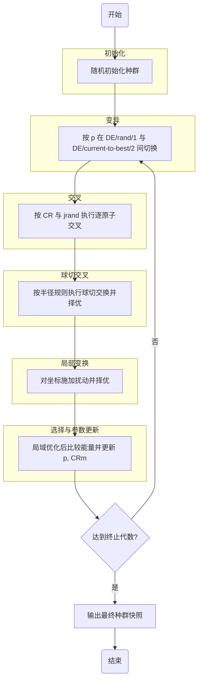

# SaNSDE_new

> 说明：本文档由 LLM 辅助生成，并结合当前代码、workflow 文档与知识库内容整理。请在正式发布或对外使用前进行人工复核。

## 代码简介

本仓库实现了一个面向纳米团簇全局优化的 SaNSDE 工作流，核心模块集中在 `SaNSDE_new.py`。

- `Population`：种群容器，维护同一化学式（同元素组成与计数）的团簇集合。
- `localOptimize`：局域优化函数，输入 `Population | Atoms`，返回新的优化对象（不原地修改输入）。
- `randomCluster`：随机生成团簇并通过传入的 `relax` 完成局域优化后加入种群。
- `mutate`（变异）/ `crossover`（交叉）/ `sphereCutSplice`（球切交叉）/ `localTransformation`（局部变换）/ `select`（选择）：SaNSDE 主循环核心环节。
- `relax`：基于 `localOptimize` 的默认偏函数，固定常用优化参数，供选择环节复用。

## 环境需求

- Python 3.13
- 依赖包：
  - `numpy`
  - `ase`

建议使用虚拟环境（conda 或 venv）管理依赖。

## 算法原理图



说明：上述流程图与当前主程序一致，包含球切交叉与局部变换步骤。

## 算法简介

本实现参考 `workflow/变异&交叉简介.md` 与知识库接口文档，核心思想如下：

1. 初始化自适应参数：
   - 变异策略概率 `p`
   - 缩放因子分布选择概率 `fp`
   - 交叉率中心 `CRm`
   默认初值均为 `0.5`。

2. 变异（Mutation）：
   - 按 `p` 在 `DE/rand/1` 与 `DE/current-to-best/2` 之间切换。
   - 缩放因子 `F` 按 `fp` 在高斯分布与柯西分布之间采样。

3. 交叉（Crossover）：
    - 按 `CR` 和 `jrand` 执行逐原子交叉，保证每个试验个体至少继承一个突变原子。
    - 在个体上记录 `CR`，并透传 `mutTag`。

4. 球切交叉（sphereCutSplice）：
   - 从 `pop` 与 `popCross` 中随机抽样做球切交换。
   - 用质心移到原点后按半径规则交换外层原子。
   - 对候选结构 `relax` 后择优。

5. 局部变换（localTransformation）：
   - 对坐标施加 `uniform(-r, r)` 扰动。
   - 对扰动前后结构比较能量，保留低能结构。
   - 透传 `mutTag` 和 `CR`。

6. 选择（Select）：
   - 对 `pop1`/`pop2` 先读取能量列表，仅对缺失能量个体执行 `relax` 补齐。
   - 按能量优劣选择下一代，并基于成功统计更新 `p` 与 `CRm`。

7. 终止与输出：
   - 达到设定代数后停止迭代。
   - 使用 `export` 导出最终 JSON 快照，可选同时输出 xyz 结构文件。

## 代码示例

### 1) 基础对象与局域优化

```python
from ase import Atoms
from ase.calculators.lj import LennardJones
from ase.optimize import BFGS

from SaNSDE_new import Population, localOptimize

cluster = Atoms("Au13", positions=[[0, 0, 0]] * 13)
pop = Population()
pop.addCluster(cluster)

calc = LennardJones()
pop_opt = localOptimize(pop, potential=calc, optimizer=BFGS, fmax=0.05, steps=100)
```

### 2) 单轮 SaNSDE（变异 -> 交叉 -> 球切交叉 -> 局部变换 -> 选择）

```python
from SaNSDE_new import mutate, crossover, sphereCutSplice, localTransformation, select, relax

pop_mut = mutate(pop_opt)
pop_cross = crossover(pop_opt, pop_mut)
pop_splice = sphereCutSplice(pop_opt, pop_cross, r=0.8, relax=relax)
pop_trans = localTransformation(pop_splice, r=0.25, relax=relax)
pop_next = select(pop_opt, pop_trans, relax=relax)
```

### 3) 导出结果

```python
# 仅导出 JSON
json_path = pop_next.export(name="Au13_snapshot")

# 同时导出 JSON + xyz 目录
json_path = pop_next.export(name="Au13_snapshot", xyz=True)
```

### 4) 种群其他操作

```python
# 索引：返回单个团簇 Atoms
first_cluster = pop_opt[0]

# 切片：返回新的 Population
sub_pop = pop_opt[::2]
print(len(sub_pop))

# 迭代
for cluster in sub_pop:
    print(cluster.get_chemical_formula())

# 当前最优团簇
best_cluster = pop_opt.bestCluster
best_energy = best_cluster.energy
print(best_cluster.get_chemical_formula(), best_energy)
```

### 5) 完整工作流脚本

可直接运行仓库根目录下的 `example.py`：

```bash
python example.py
```

该脚本会：

- 随机生成 12 个 `Au13` 团簇并初始化
- 使用默认 `relax()` 执行 10 代优化（快速测试配置）
- 每代输出：代数、最低能量、与上一代最优能量差、本轮耗时
- 最后导出最终快照

## 参考资料

- `workflow/变异&交叉简介.md`
- `workflow/算法流程图(SaNSDE).md`
- `SaNSDE/05-AI接口文档/`（Obsidian 知识库）
