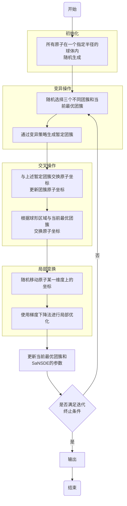

# 算法流程图 (SaNSDE)

该文档描述了 SaNSDE 算法的执行流程。

## Mermaid 流程图

## 文本描述

1.  **开始**
2.  **初始化**:
    *   所有原子在一个指定半径的球体内随机生成。
3.  **进入主循环**:
    *   **变异操作**:
        *   随机选择三个不同团簇和当前最优团簇。
        *   通过变异策略生成暂定团簇。
    *   **交叉操作**:
        *   与上述暂定团簇交换原子坐标，更新团簇原子坐标。
        *   根据球形区域与当前最优团簇交换原子坐标。
    *   **局部变换**:
        *   随机移动原子某一维度上的坐标。
        *   使用梯度下降法进行局部优化。
    *   **更新状态**:
        *   更新当前最优团簇和 SaNSDE 的参数。
    *   **判断终止条件**:
        *   若**未满足**迭代终止条件：返回执行**变异操作**。
        *   若**满足**迭代终止条件：继续下一步。
4.  **输出**: 输出结果。
5.  **结束**
